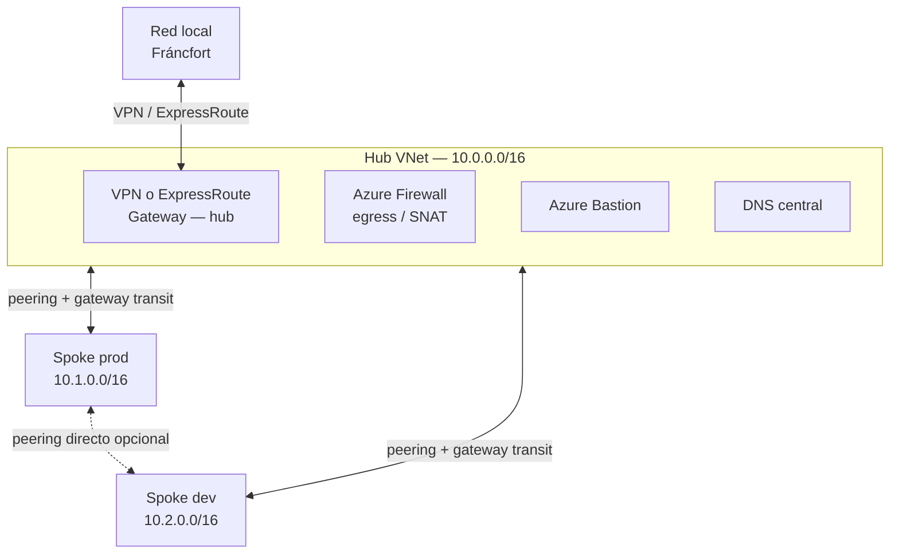

# Hub-Spoke

Topología de red recomendada por el Cloud Adoption Framework: un **hub** (VNet central con servicios compartidos) y **spokes** (VNets de carga de trabajo aisladas) conectadas por **peering**. Es la respuesta patrón a "varios entornos que necesitan servicios compartidos sin conectarse entre sí" y a "control centralizado de la salida a internet".

## El hub

- VNet regional que aloja lo compartido: **puerta de enlace cross-prem (VPN/ExpressRoute)**, **Azure Firewall** (egress/ingress, SNAT), **Azure Bastion** para acceso RDP/SSH a todas las spokes, y **DNS** (resolver/zonas) — incluidas las zonas `privatelink.*` de los private endpoints.
- **Un hub por región**: si hay cargas en varias regiones, un hub en cada una.
- Punto único de salida a internet (egress) y, opcionalmente, de entrada publicada con DNAT.

## Las spokes

- Aíslan cargas: cada spoke un entorno/carga (prod, dev…), pueden vivir en **suscripciones distintas** (el peering funciona cross-suscripción e incluso cross-tenant).
- En general, cada spoke se empareja **solo con su hub de su misma región**.
- No despliegan su propia puerta de enlace: usan la del hub (ver abajo).

## El peering no es transitivo — el punto que más se pregunta

**Hub ↔ spoke no da spoke ↔ spoke.** Opciones para comunicar dos spokes:

1. **Peering directo entre ellas** — la de **menor latencia** (sin hop intermedio); recomendada si el número de peerings no se dispara.
2. **UDR por el firewall/NVA del hub** — cuando hay tantas spokes que el full-mesh no cabe (hay límite de peerings por VNet); añade un hop.

Y la tránsito del gateway — **la pareja inseparable de examen**:

| Lado | Configuración | Efecto |
|---|---|---|
| Peering **hub → spoke** | **Allow gateway transit** | La gateway del hub acepta tráfico de la spoke |
| Peering **spoke → hub** | **Use remote gateways** | La spoke enruta su tráfico híbrido por la gateway del hub |
| Ambos | **Allow forwarded traffic** | Se permite el tráfico remitido por equipos del otro lado |

Con solo una de las dos primeras, la spoke no alcanza on-prem. Una spoke **no puede** tener su propia gateway y usar la remota a la vez.

## Subredes con nombre obligatorio y tamaño

| Subred | Tamaño mínimo | Notas |
|---|---|---|
| `GatewaySubnet` | **/26** recomendado | Para la VPN/ExpressRoute gateway; escalabilidad futura |
| `AzureFirewallSubnet` | **/26** | **No admite NSG** |

## SNAT/DNAT a través del firewall del hub

- **Salida (SNAT):** todo lo que sale de una spoke aparece con una IP pública del firewall → las listas blancas de terceros deben cubrir el conjunto (usa un **prefijo de IP pública** para expresarlo como rango). Para más presupuesto de puertos SNAT, attacha un **NAT Gateway** a `AzureFirewallSubnet`.
- **Entrada (DNAT):** publicas un backend en la IP pública del firewall; el backend ve como origen la IP del firewall (no la del cliente) — si necesitas la IP real del cliente, termina la conexión en un proxy (Application Gateway / Front Door) con `X-Forwarded-For`.

## Alternativas

- **Azure Virtual WAN**: hub gestionado por Microsoft, para muchas regiones/sedes. El hub-spoke casero da más control (NVAs propias) y ahorra coste en tamaños medianos.
- **Azure Virtual Network Manager**: connected groups y configuración hub-spoke declarativa en vez de peerings manuales.
- **Azure Route Server**: transición entre ExpressRoute y VPN, prefijos BGP personalizados.

## Casos de uso típicos

- Entornos dev/test/prod que comparten DNS, AD DS, NTP → hub compartido, un entorno por spoke.
- Cargas que **no** necesitan hablarse entre sí pero sí servicios comunes.
- Control central de seguridad (firewall perimetral) y de conectividad.

## Gotchas de examen

- "Las spokes usan la gateway del hub" → **allow gateway transit** (hub) **+ use remote gateways** (spoke) — pregunta de elige-dos clásica.
- Spoke a spoke con **mínima latencia** → peering directo, no UDR por el hub.
- `AzureFirewallSubnet` **sin NSG** y ambas subredes a **/26**.
- El hub es **regional**: dos regiones = dos hubs.
- Bastion desplegado en el hub da acceso a VMs de **VNets emparejadas** sin IP públicas.

## Relacionado

- [Peering de VNets (AZ-104)](az104-vnet-peering.md)
- [Rutas definidas por el usuario (AZ-104)](az104-user-defined-routes.md)
- [Redes virtuales (AZ-104)](az104-virtual-networks.md)
- [Private Endpoints](private-endpoints.md)
- [Azure DNS (AZ-104)](az104-azure-dns.md)
- [Índice AZ-104](../certifications/AZ-104/INDEX.md)

## Fuentes

- [Hub-spoke network topology — Azure Architecture Center](https://learn.microsoft.com/en-us/azure/architecture/networking/architecture/hub-spoke) (copia local: `raw/architecture-center/docs/networking/architecture/hub-spoke-content.md`)
- [Hub and spoke network topology — Cloud Adoption Framework](https://learn.microsoft.com/en-us/azure/cloud-adoption-framework/ready/azure-best-practices/hub-spoke-network-topology)
