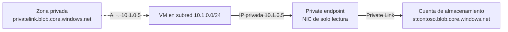

# Private Endpoints

Un **private endpoint** es una interfaz de red con una **IP privada de tu VNet** que conecta de forma privada con un servicio por medio de Azure Private Link — Storage, SQL Database, Cosmos DB, Key Vault, App Service, o un servicio propio tuyo expuesto con Private Link service. Efectivamente, *traes el servicio dentro de tu red*.

## Cómo funciona

- La NIC del private endpoint se crea **automáticamente**, es de **solo lectura** y recibe una IP **dinámica que no cambia** durante todo su ciclo de vida (la IP es de la subred donde lo despliegas).
- La conexión es **unidireccional**: la inician siempre los clientes hacia el servicio; el proveedor no puede iniciar conexiones hacia el cliente.
- Accesible desde: la misma VNet, VNets emparejadas (regionales y globales), **on-prem por VPN o ExpressRoute**, y otros servicios con Private Link.
- Se despliega en la **misma región y suscripción que la VNet**; el recurso de destino (private-link resource) puede estar en otra región.
- Se pueden crear varios private endpoints al mismo recurso; recomendado **uno por recurso y VNet** para evitar duplicados en DNS.
- Para Storage: private endpoints solo en cuentas **GPv2**.

## Subrecursos: un endpoint por dato

Cada private endpoint apunta a un **subrecurso** concreto. En Storage, `blob` y `file` son subrecursos distintos → para acceder a blobs y a file shares por IP privada hacen falta **dos private endpoints**. La plataforma solo deja pasar las conexiones dirigidas al recurso/subrecurso del endpoint.

## El endpoint privado NO cierra el público

Un private endpoint da una IP privada de acceso, pero **no restringe por sí solo el acceso público** al recurso. Para acceso exclusivamente privado hay que deshabilitar el acceso de red pública del recurso (o restringirlo con reglas de firewall) — las dos cosas por separado.

## Aprobación de la conexión

| Método | Cuándo | Estados |
|---|---|---|
| Automática | Tienes permiso sobre el recurso destino (`.../privateEndpointConnectionsApproval/action`) | Aprobada al crear |
| Manual | Sin permisos: el dueño del recurso aprueba | **Pending → Approved / Rejected / Disconnected** |

Solo los endpoints en estado **Approved** pueden enviar tráfico. Para conectar con el servicio de un tercero se usa un **alias** que comparte el dueño del servicio.

## DNS — la clave de que funcione

El FQDN público (`stcontoso.blob.core.windows.net`) sigue resolviendo a IPs públicas salvo que configures DNS. El patrón: **zona DNS privada `privatelink.<subdominio>`** (p. ej. `privatelink.blob.core.windows.net`) vinculada a la VNet, con un registro A que apunta a la IP del private endpoint. Los clientes resuelven el FQDN *sin cambiar de nombre* a la IP privada. Sin DNS correcto, el endpoint existe pero nadie lo usa.

## Decisiones de examen: service endpoint vs private endpoint

| | Service endpoint | Private endpoint |
|---|---|---|
| Qué da | Ruta optimizada por la troncal a la IP **pública** del servicio; la VNet queda identificada en el firewall del recurso | **IP privada** del servicio dentro de tu VNet |
| ¿Sirve desde on-prem (VPN/ExpressRoute)? | **No** — solo tráfico originado en la VNet | **Sí** |
| Granularidad | Servicio completo (p. ej. `Microsoft.Storage` de la subred) | Por recurso/subrecurso (blob vs file…) |
| Coste | Gratis | Con coste por endpoint + datos |
| Regla típica del examen | "Solo desde esta VNet, sin coste, sin IP privadas" → **service endpoint** | "Solo por IP privada", "también desde on-prem", "sin endpoint público" → **private endpoint** |

## NSG y UDR sobre private endpoints

- Por defecto las políticas de red están **deshabilitadas** en la subred: para aplicar NSG/UDR/ASG al private endpoint hay que habilitar **network policies** en la subred.
- Las reglas efectivas y rutas efectivas **no se muestran** en la NIC del private endpoint.
- Con un NVA en medio, Microsoft recomienda **SNAT** del tráfico hacia el private endpoint para que el retorno fluya simétrico (evitable con `disableSnatOnPL`).

## Gotchas de examen

- "Acceso a Storage **solo desde on-prem por ExpressRoute** sin exponer endpoint público" → private endpoint (+ zona `privatelink.*`), no service endpoint.
- Necesitas blob **y** file por IP privada → **dos** private endpoints (subrecursos distintos).
- La IP del endpoint es dinámica a la creación pero **fija** después; no se puede poner estática a mano.
- El endpoint en estado Pending/Rejected **no pasa tráfico** — solo Approved.

## Relacionado

- [Redes virtuales (AZ-104)](az104-virtual-networks.md)
- [Hub-Spoke](hub-spoke.md)
- [Azure Networking](azure-networking.md)
- [Shared Responsibility Model](shared-responsibility-model.md)
- [Índice AZ-104](../certifications/AZ-104/INDEX.md)

## Fuentes

- [What is a private endpoint? — Microsoft Learn](https://learn.microsoft.com/en-us/azure/private-link/private-endpoint-overview) (copia local: `raw/azure-docs/articles/private-link/private-endpoint-overview.md`)
